# Report figures

Generated by `generate_report_figures.py` (light background, 200 dpi).

## fig01_class_balance.png
**Only 4.55% of vehicles carry the high-risk label**  
Predicting 'low risk' for every vehicle would score 95.45% accuracy and find no failures, so accuracy alone is not used to judge models.

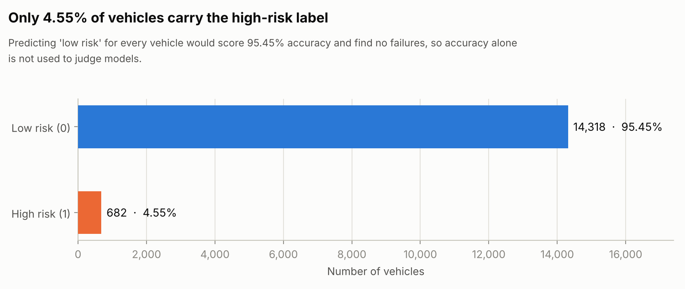

## fig02_feature_distributions.png
**Mileage, age, oil quality and brake wear separate the classes; RPM, vibration and coolant barely do**  
Density of each feature for low-risk and high-risk vehicles (all 15,000 rows). AUC = how well that one feature separates the classes (0.5 none, 1.0 perfect); ↑ higher values are riskier, ↓ lower values are riskier.

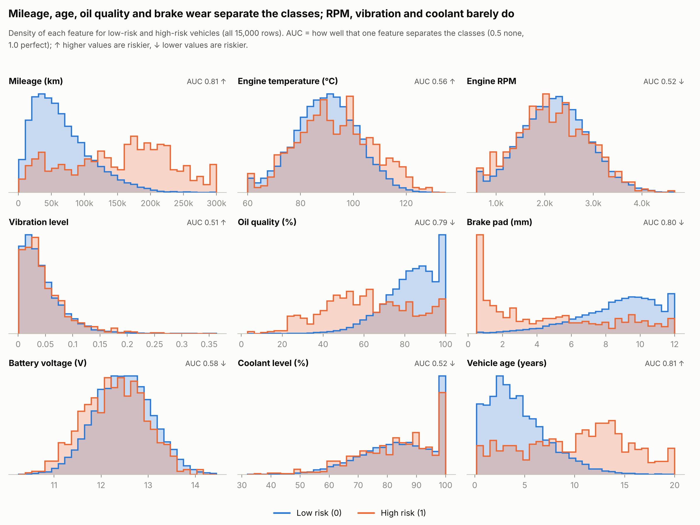

## fig03_failure_rate_by_feature.png
**Failure rate rises steadily with wear; temperature and battery matter only at the extremes**  
High-risk share (%) within each fifth of the feature's range (equal-sized groups). Dashed line = dataset average. RPM, vibration and coolant show no clear pattern.

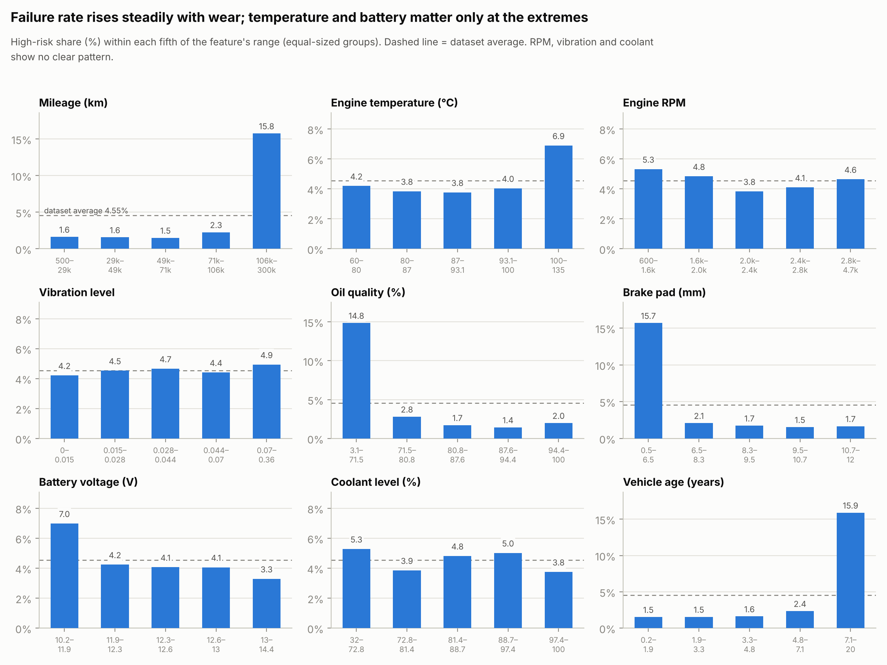

## fig04_correlation_heatmap.png
**Mileage, age, brake wear and oil quality are heavily intercorrelated (|r| up to 0.97)**  
Correlated features share credit in feature-importance and SHAP results, so rankings among them should be read with care.

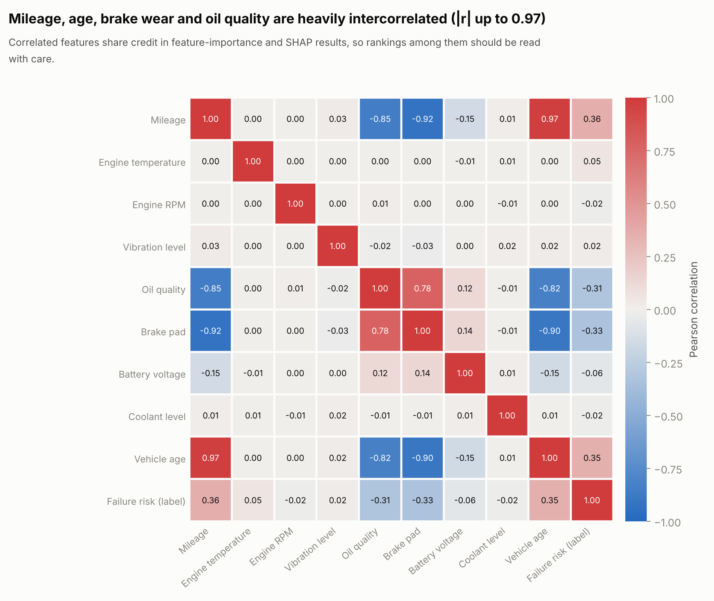

## fig05_model_comparison.png
**After tuning, the three models are statistically close; XGBoost scores highest**  
5-fold stratified CV on the training split. Tuned average precision spans 0.015, smaller than the fold-to-fold SD (≥ 0.040). ○ default settings, ● tuned, whiskers = ±1 SD across folds (average precision panel).

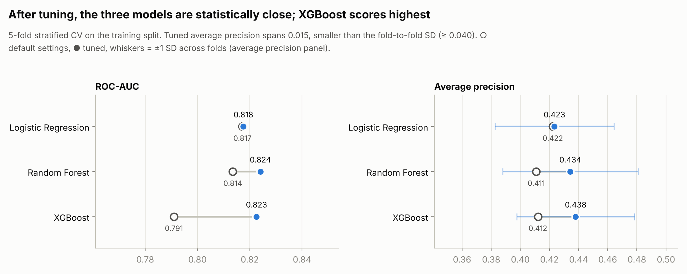

## fig06_threshold_tradeoff.png
**Raising the threshold trades recall for precision; 0.825 maximises F1**  
Out-of-fold predictions on the training split only (test labels were not used to choose the threshold).

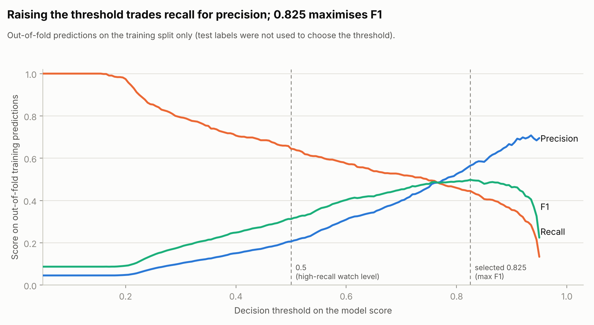

## fig07_confusion_matrices.png
**Held-out test: 56 of 136 high-risk vehicles caught at 0.825; 90 at 0.5 with 358 false alarms**  
3,000 untouched test vehicles. Colour = share of each actual class; counts are numbers of vehicles.

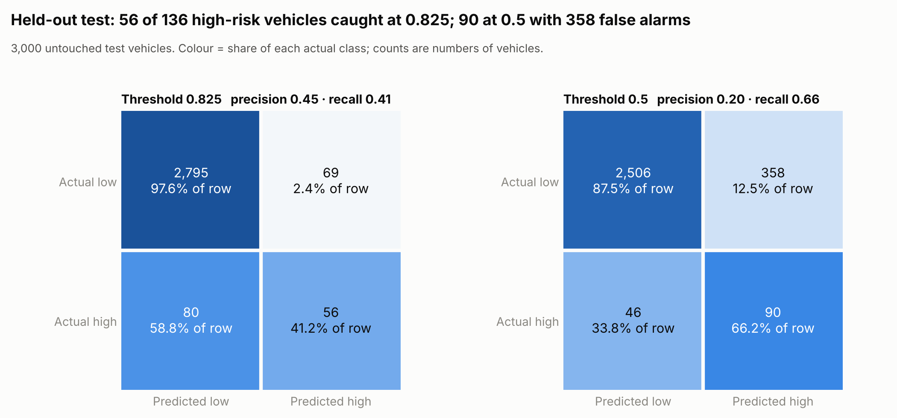

## fig08_roc_pr_curves.png
**Held-out test: ROC-AUC 0.851, average precision 0.420 (no-skill 0.045)**  
Black dots mark the two operating thresholds. Scores come from the final tuned XGBoost model.

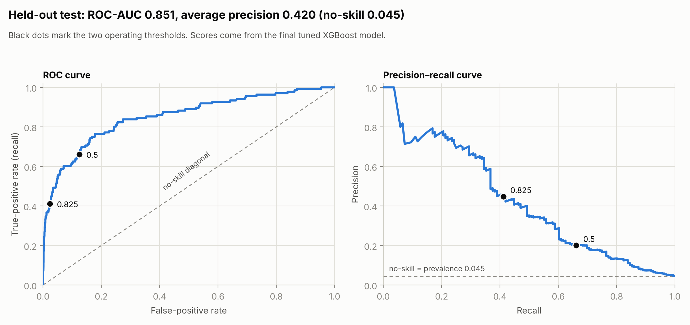

## fig09_shap_importance.png
**Mileage, brake pad and vehicle age carry most of the model's weight**  
Average size of each feature's SHAP contribution over the 3,000 test vehicles. Correlated wear features share credit.

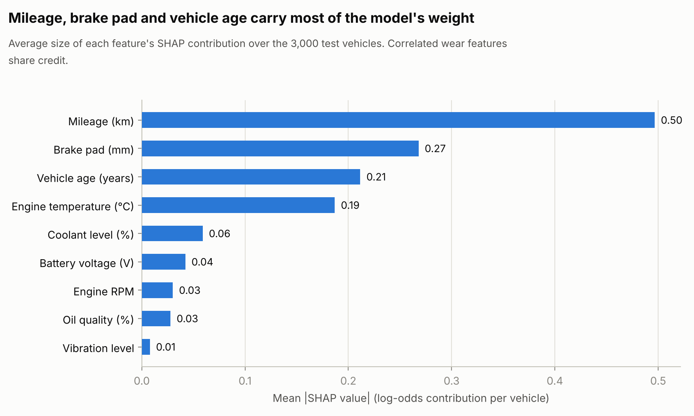

## fig10_shap_beeswarm.png
**How each feature value pushes a vehicle toward higher or lower risk**  
Each dot is one test vehicle; colour = feature value (red high, blue low). Right of zero = pushes toward the high-risk label.

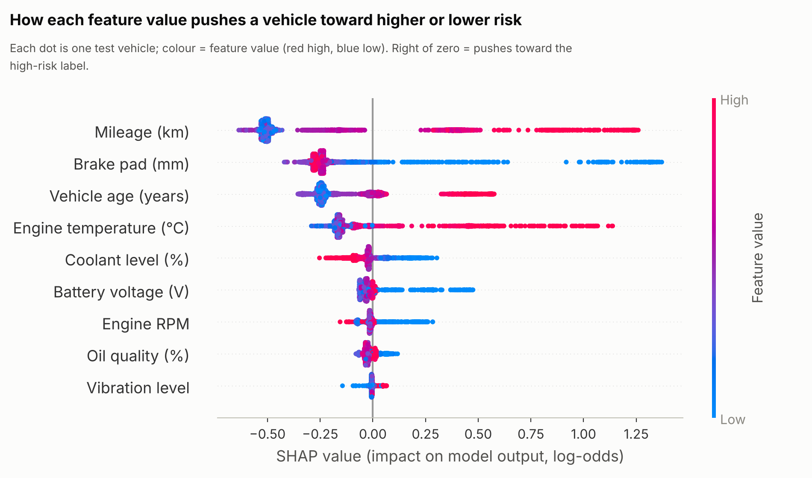

## fig11_risk_bands.png
**The model's HIGH band carried the high-risk label 56.5% of the time, versus 1.8% in LOW**  
Risk bands shown in the app (LOW / MODERATE / HIGH), checked against the dataset label using out-of-fold training predictions.

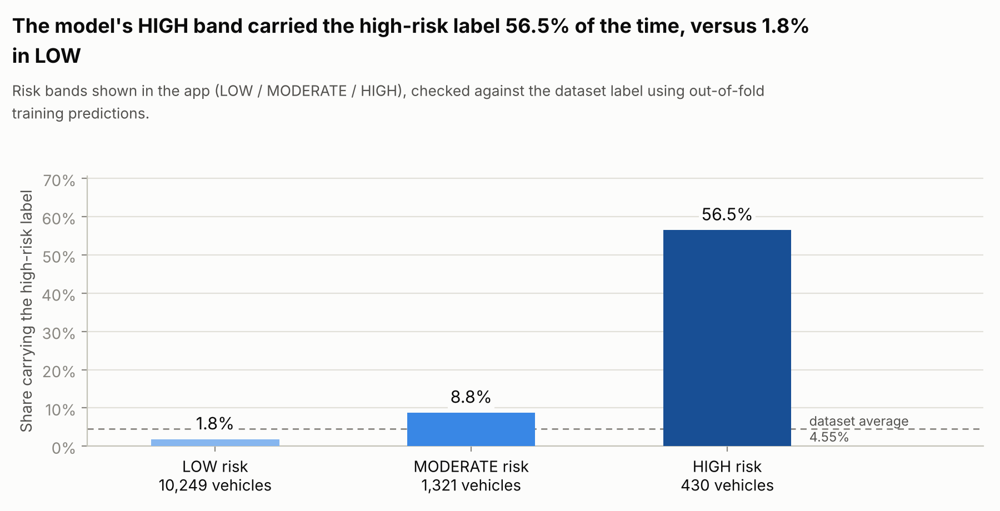

## fig12_rule_evidence.png
**Most maintenance rules are well supported by the data; coolant and battery rules are weak**  
Association of each rule-based advisory with the dataset label (training split). Weak rules reflect general maintenance practice, not this dataset.

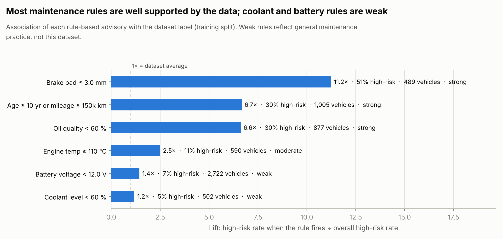
